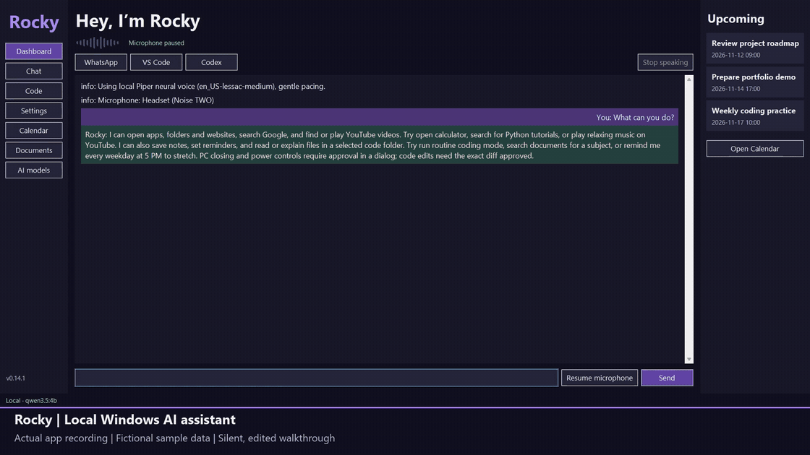
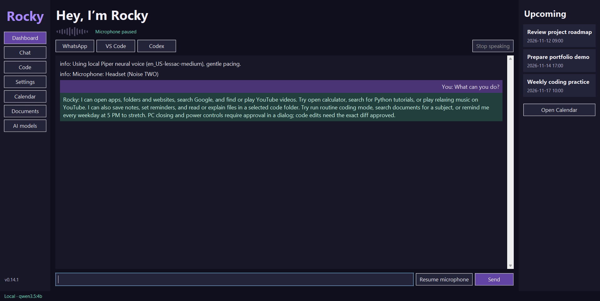
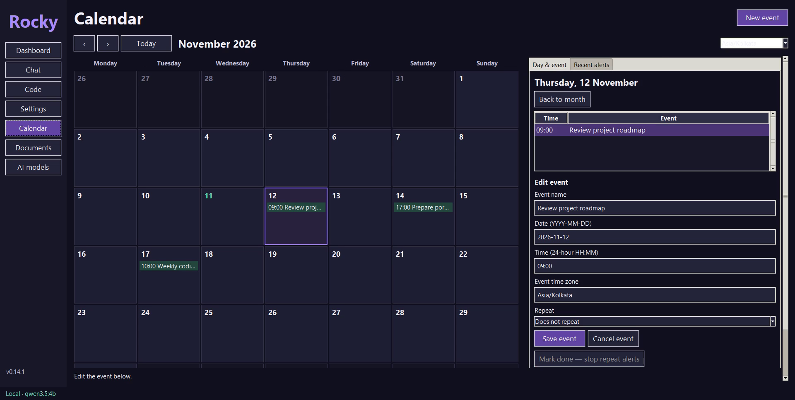
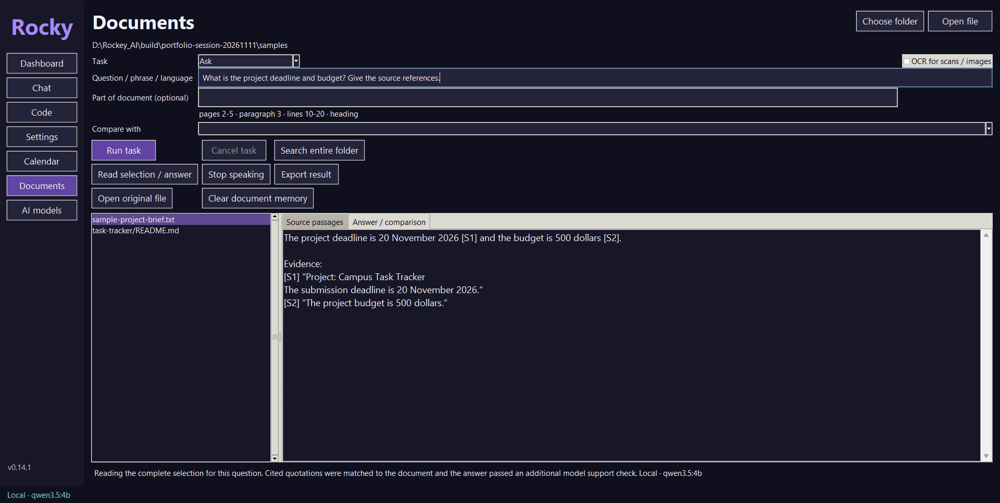
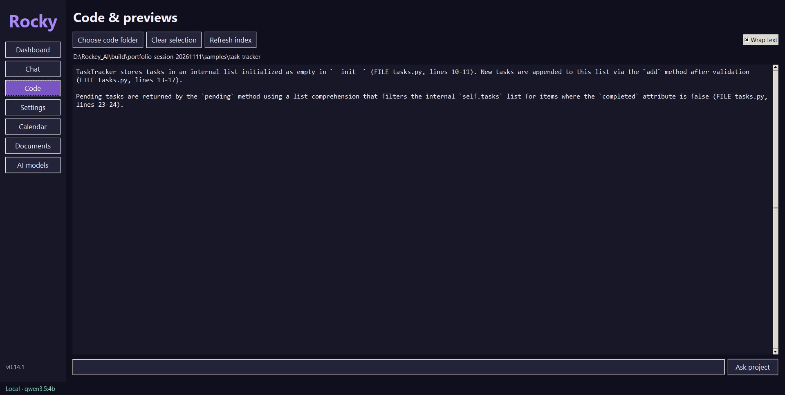

# Rocky — Windows AI assistant

Rocky is a personal Windows desktop assistant built with Python and Tkinter.
It combines local AI conversation, voice input, document question answering,
reminders and desktop actions in one application.

## Demo



[Watch or download the full-resolution walkthrough (MP4)](docs/media/rocky-demo.mp4).

This 35-second screen recording shows the dashboard, integrated calendar,
source-based code explanations and document Q&A with source quotations. It uses
text input and fictional sample data with local Ollama models. Audio is omitted
and long processing waits are shortened; this is a feature demonstration, not a
latency or speech-accuracy benchmark. The [sample files](docs/demo/README.md) are
included for trying the same questions.

<details>
<summary>Full-size screenshots</summary>

| Dashboard | Calendar |
| --- | --- |
| [](docs/media/rocky-dashboard.png) | [](docs/media/rocky-calendar.png) |

| Document Q&A | Coding assistant |
| --- | --- |
| [](docs/media/rocky-document-qa.png) | [](docs/media/rocky-code-assistant.png) |

[View the source-passage screenshot](docs/media/rocky-document-sources.png).

</details>

## Project overview

- **Local AI:** Ollama integration with task-specific models and a local fallback.
- **Voice interaction:** wake phrase detection, local speech recognition and speech output.
- **Document Q&A:** temporary in-memory retrieval with source references and evidence checks.
- **Desktop tools:** open apps and folders, search the web and find YouTube videos.
- **Productivity:** persistent reminders, a calendar, notes and custom routines.
- **Coding assistance:** inspect a selected project and review single-file edit proposals.
- **Action approval:** code changes and sensitive PC actions require explicit approval.
- **Optional cloud inference:** NVIDIA NIM for selected tasks, disabled by default.

### Technology

Python, Tkinter, Ollama, SQLite, Vosk, Whisper, Windows SAPI and optional Piper.
Optional dependencies are split across the `requirements-*.txt` files.

### Source layout

| Path | Purpose |
| --- | --- |
| `rocky/` | Desktop interface, AI providers, voice, documents and action services |
| `scripts/` | Model setup, Windows packaging and verification utilities |
| `tests/` | Automated regression tests |
| `requirements*.txt` | Core and optional dependency lists |
| `ARCHITECTURE.md` | Component design, action boundaries and implementation notes |

### Run from source

On Windows with Python 3.10+ and Tkinter, run these commands from the project folder:

```powershell
python -m venv .venv
.\.venv\Scripts\python.exe -m pip install -r requirements.txt
.\.venv\Scripts\python.exe scripts/download_model.py
.\.venv\Scripts\python.exe -m rocky
```

For AI conversation, install [Ollama](https://ollama.com/download/windows) and
download the conversation model described below. Advanced voice and document
features require their optional dependencies; see the detailed setup sections.

### Verification and limitations

```powershell
.\.venv\Scripts\python.exe -m unittest discover -s tests -v
```

This is a personal project under active development. Automated checks do not
establish real-world speech accuracy. Document answers can contain extraction or
model errors; verify important claims against their references. Reminders require
the relevant application process to be running. Optional cloud tasks send selected
content to the configured provider.

Model weights, virtual environments, personal databases, credentials and Windows
build outputs are excluded from the source repository. Download models separately
and check their licenses before redistributing them.

## Development notes and detailed setup

## Rocky 0.14.1 — readable code answers and previews

Code answers wrap to the window width by default. Turn off **Wrap text** on the
Code page to preserve long code lines and use the bottom horizontal scrollbar.
Edit previews also have a horizontal scrollbar, so long diff lines remain
accessible. Both viewers resize with the window and keep vertical scrolling.

## Rocky 0.14.0 — temporary document memory and supported answers

Open **Documents → Open file**, or select a file in the library. Rocky extracts
the text and prepares embeddings before Q&A. Wait for **Ready**, enter a question
with **Ask** selected, then click **Run task**. PDF, DOCX, XLSX, PPTX, text/Markdown,
CSV, HTML and images use the same preparation path. Enable OCR for scanned PDFs;
images enable it automatically when opened.

Document text and embeddings are held in RAM for the current session. Rocky does
not copy the original PDF into a permanent library or save a new vector database.
Closing Rocky releases this session memory, and a fresh launch starts empty.
Extraction workers use short-lived temporary result files removed after reading.
The bounded RAM index allows up to 20 prepared selections / 64 MB of vectors and
chunk text, plus the existing bounded extraction cache. Opening another document
does not require re-downloading an AI model.

**Clear document memory** in Documents or AI models removes all prepared document
indexes, decoded text, selection and document answers while Rocky stays open.
You can also say/type `clear document memory`. It removes pending document read
aloud messages while preserving reminder announcements. Old results are invalidated
so an in-flight answer cannot bring cleared data back. A blocked HTTP request may
still finish or wait for its timeout; its result is discarded. Original files,
exports, saved notes, reminders and downloaded Ollama models are preserved.
The recognised vectors-only disk cache from Rocky 0.13.x is removed on startup or
when memory is cleared. A linked or unrecognised database is preserved with guidance.

Specific questions use semantic and exact-word retrieval with neighbouring
passages. Whole-document questions retain complete source coverage. Rocky first
extracts quotations, matches them against the actual text, includes nearby
conditions/exceptions, and then writes an answer with clickable references.
Unsupported numbers or citations are rejected, and another model pass checks
the proposed answer against its evidence. The answer includes its source quotes.
If a concise answer cannot be verified, Rocky shows the source passages. If no
supporting passage is found, it says so. Large evidence sets remain extractive
instead of silently dropping passages to fit the answer model's context.

These checks improve grounding, not certainty: OCR, complicated tables, ambiguous
wording and model errors can still affect results. Check important answers against
the cited page/paragraph. Local document memory clearing does not control an online
provider's retention if you explicitly enable NIM document analysis.

## Rocky 0.13.1 — accuracy and recovery fixes

Natural time/date questions use the computer's clock, including while a reminder
draft is waiting for its message. Clock questions cannot accidentally become
reminder bodies. Complete-document questions (all/list/count/compare/overview)
read the full selected source; short questions on small documents skip indexing.
Indexed retrieval remains available for specific questions on longer sources.
Multi-part answers collect evidence from each section before combining it, so
missing information in one part is not treated as missing from the entire file.
An answer without source identifiers is replaced with a clear not-found message.

Translation validation now checks added/missing numbers, occurrence counts,
negative signs and percentages. Numeric-only passages do not need translated
letters. Search rebuilds malformed vector-cache entries automatically. Malformed
local/NIM responses produce recoverable errors, and a failed model is released
before switching to its backup. Missing-model guidance names the actual model.

New-question interruption now cancels document requests started by the current
voice/text conversation, without cancelling an independent Documents-page job.
An already blocked HTTP call can still wait for its response or existing timeout.
Invalid code-folder launch arguments show an error in Rocky instead of crashing.
Automated tests and synthetic speech checks do not establish accuracy for a real
microphone/accent; use the guided calibration to measure it.

## Rocky 0.13.0 — models by task

Rocky now chooses a local model for each task. Defaults are Qwen3.5 4B for
conversation, coding and document analysis, TranslateGemma 4B for translation,
EmbeddingGemma for document retrieval and Qwen3 4B as a local backup. Download
the models once through Ollama:

```powershell
ollama pull qwen3.5:4b
ollama pull translategemma:4b
ollama pull embeddinggemma
ollama pull qwen3:4b
```

Open **AI models** in the sidebar to inspect or change these choices. **Check
installed local models** reads the local installation. Save, then reopen Rocky
to apply preferences. The footer identifies the provider/model in use.
`--brain-model TAG` overrides the conversation model for one launch. The local
backup is used after a failed request; cancellation never starts a fallback.
Once speech has started streaming, a failed answer is not replayed through a
second model. Conversation memory continues to use local Ollama only.

Documents now prepare a temporary index on opening, and Q&A requires preparation.
Source text, location and embedding model version determine the cache identity.
Specific questions retrieve hybrid-ranked passages plus neighbours; whole-document
questions and small files retain complete coverage. The index is reused only within
the running session. Embedding inference uses
CPU to preserve GPU memory for the main model. Rocky serializes local inference
and releases its previous main model when switching.

Translation uses the specialist's single-message prompt, preserves source
references outside the model response and checks that source numbers survive.
Enter **Tamil** for English-to-Tamil, or **Tamil to English** to choose both
languages. Source passages split at sentence/word boundaries where possible.
Synthetic Tamil and Spanish samples improved in live checks; translation remains
generated text and needs review for meaning and names.

Optional NVIDIA NIM can be enabled independently for coding/edit proposals and
document analysis, including study tools. These tasks send selected source
excerpts and the question to NVIDIA. Conversation, translation and retrieval stay
local. Online tasks are off by default. Enter the API key directly in **AI
models**; it is stored in Windows Credential Manager, never in SQLite or logs.
NIM uses a fixed HTTPS endpoint with redirects disabled, a 45-second request
timeout and local fallback after failure. Structured output cannot execute
actions; code writes still need the existing exact-diff approval. NIM account
access, API limits and model availability depend on NVIDIA. Live hosted inference
requires your key and has not been verified by the local release check.

References: [TranslateGemma prompt guide](https://ollama.com/library/translategemma),
[Ollama embedding API](https://docs.ollama.com/api/embed),
[NVIDIA API setup](https://build.nvidia.com/nvidia/nemotron-3.5-super-vl-120b-a12b).

## Rocky 0.10.2 — message popups

Reminder alerts now appear as compact dark message cards at the lower-right of
the screen, above the taskbar. They disappear after **four seconds**, do not take
keyboard focus, and do not create a taskbar tab. Snooze and Done remain available
on the card; full reminder details remain in Calendar. Calendar status/errors
and important Rocky status/error alerts use the same popup style. Ordinary
startup and listening messages stay in the chat log to avoid popup spam.

Use **Settings → Test notification** or **Calendar → Test notification** to try
the popup without creating an event. Quit Rocky and **Quit Rocky Calendar from
the tray**, then reopen Rocky Assistant to load this update.

## Earlier reliability fixes

This update fixes shutdown cancellation when another approval is pending, and
serializes cancellation with approval execution. Reminder edits preserve monthly
and leap-day anchors; snoozing an “until done” event postpones that event instead
of creating duplicate alerts. Marking it done also retires legacy one-time snoozes.

Document search matches whole words (including C++/C#) instead of unrelated
substrings, and discards AI answers after the document folder changes. Routine
saves merge atomically across app instances. Calibration reports cannot apply
settings after the selected microphone changes.

## Seven-feature milestone

Quit Rocky and choose **Quit Rocky Calendar** in its tray menu before opening this
release. Closing Calendar with X only hides it. Restart both processes so the new
reminder schedules are handled by the updated Calendar service.

| Feature | Where to use it |
| --- | --- |
| Personal voice calibration | Settings → Test microphone & voice accuracy → Start guided personal calibration. Then open Personal calibration report. |
| App clarification | Try an unclear app name. Rocky suggests a match and waits for your answer; it never launches a fuzzy match automatically. |
| Natural interruptions | Enable Voice stop while speaking (headset). Say **wait**, **change that**, or **Hey Rocky, your new question** during a reply. |
| Advanced reminders | Calendar repeat picker: weekdays, monthly, yearly/birthday, or every five minutes until marked done. |
| PC controls with approval | Say **close Notepad**, **restart Windows**, or **shut down Windows**. Review the exact dialog and click Approve. |
| Custom routines | Settings → Routines. Save a name and one command per line, then say **run routine coding mode**. |
| Documents and notes | Documents in the sidebar. Open files, search, summarize, ask questions, inspect sources and export results. |

The guided calibration session records 18 short samples only when you click
Record phrase. Advice uses the selected microphone's measurements, excludes
interrupted/clipped/very quiet recordings, compares processor speed only for
matched phrases and conditions, and separates quiet/noisy scores. You review
proposed settings before applying them. Processor changes need a restart. Real
80% recognition accuracy must be measured with your own headset; it is not
established by automated synthetic-audio checks.

For a new question during speech, include **Hey Rocky**. The optional headset
listener stops playback, verifies the new utterance, and queues it. Streamed AI
generation can be cancelled for the new question. Ordinary Stop speaking keeps
the existing text response. Speaker echo can still interfere with interruption.

Reminder examples:

```text
remind me every weekday at 5 PM to stretch
remind me every month on 15 November at 9 AM to check subscriptions
remind me every year on 20 November at 9 AM to wish Mom a happy birthday
remind me in ten minutes to take a break until I acknowledge it
mark reminder 12 done
```

Weekdays skip Saturday and Sunday, not public holidays. Monthly schedules retain
the original day: January 31 → February 28 → March 31. Leap-day birthdays use
February 28 in non-leap years. “Until done” alerts repeat every five minutes and
survive restarts; click Done in the popup or Mark done in Calendar, or use the
reminder ID in a voice/text command to stop them.

PC action previews expire after 60 seconds, are invalidated by another request,
and can be approved once. Voice/text cannot approve them. Closing sends a polite
window-close request and rechecks process identity and window title; it never
kills a process. Power actions use the [Windows non-forcing shutdown API](https://learn.microsoft.com/en-us/windows/win32/api/winreg/nf-winreg-initiatesystemshutdownexw)
with a 30-second countdown. Say **cancel shutdown** to abort the countdown.
Windows may still require you to save or close an app. Actual shutdown/restart
is deliberately excluded from automated testing; native calls are mocked there.

Routines support up to ten app/folder/web/Google/YouTube commands and stop on
the first reported failure. They are saved locally. Routines cannot contain code
edits, close commands, power actions, or arbitrary shell commands.

**Documents** in Rocky's sidebar opens an integrated file library, source viewer
and answer panel. Choose **Open file** or **Choose folder**, select a document,
choose a task and click **Run task**. All document text is processed locally.
The supported formats are PDF, Word `.docx`, text, Markdown, CSV, Excel `.xlsx`,
PowerPoint `.pptx`, HTML and common images. Old `.doc`, `.xls` and `.ppt` files
need to be saved in their modern formats first.

Tasks include keyword and exact phrase search, finding passages by meaning,
questions, complete-document summaries, section summaries, simpler explanations,
detail extraction, finding existing questions, quizzes with answer keys,
flashcards, translation, structured tables and text comparison. For comparison,
choose a second file in **Compare with**. For translation, enter the language
in the question field. **Part of document** accepts `pages 2-5`, `paragraph 3`,
`lines 10-20`, `slides 2-4`, or a heading. Word uses paragraph references rather
than layout-dependent page numbers. PDF lines follow extracted reading order.

Click an `[S#]` reference in an answer to see its source passage. **Find by
meaning** uses the local model and accepts only quotes found in the source text.
AI citations identify source passages; check the passage when accuracy matters.
The reader covers all extracted content within its limits. Long summaries
process every chunk and combine the results. A **Cancel task** button stops
between model calls and terminates active extraction. OCR reads scans/images
locally when **OCR for scans / images** is checked. OCR and translation can
misread names, numbers or meaning. Translation quality depends on the local model.
The old Qwen3 4B translator produced Tamil meaning errors. The new specialist
improved the checked samples; review translations rather than treating them as verified.

**Read selection / answer** speaks selected text, or up to 5,000 characters of
the current source/answer. **Stop speaking** interrupts it. Export derived
results and source passages to Word, Markdown or text. **Tables** can export
structured rows to CSV. PDF table text can be requested through **Extract
details**, but complex layouts require checking. Exports require a new filename;
existing files are never overwritten. Original files are read only.
Voice/text commands include `summarize document report.docx`, `summarize this
document`, `ask this document: when is delivery due?`, `make a quiz from this
document`, `make flashcards from this document`, and the existing
`search documents for TOPIC` and `ask documents: QUESTION` commands.

Limits are 40 MB per file, 500 PDF pages, 600,000 extracted characters and
10,000 source sections. Oversized files are rejected with an explanation.
Text files are limited to 2 MB. Worksheets are limited to 10,000 rows and
256 columns each. Reading runs in a separate process with a three-minute
timeout. Folder keyword searches cover up to 100 eligible files and 2,000
recent notes with a time budget. Select one file for a complete search or
semantic lookup. The library lists up to 500 files. Folder selection lasts
for the current session. Links, junctions, hidden locations, known credential
files and encrypted PDFs are excluded. Word text boxes, headers and footers,
slide chart graphics and image content beyond OCR are not interpreted.

Source setup for document support:

```powershell
.\.venv\Scripts\python.exe -m pip install -r requirements-documents.txt
```

## Earlier reliability updates

This reliability update fixes voice-stop listeners after microphone changes,
stopping buffered audio, and recovery after a speaker disconnect. Piper stays
available for a later retry when playback fails.

App commands accept phrases such as “open the calculator” and “open my browser”.
Reminder corrections after snoozing now change that snoozed alert. Weekday/date
clauses stay attached to reminder times, and compact times such as `5.30pm` work.
Unclear date wording asks for clarification before saving.

Code edit previews preserve the punctuation in your request, validate Python's
declared encoding against its UTF-8 bytes, and reject invalid JSON numeric values.
Saved conversation text is checked before loading or display.

## Previous reliability fixes

Reliability fixes preserve one-sentence wake commands, discard voice commands
after microphone pause, and prevent stale Calendar or voice edits from
overwriting a changed reminder. Spoken durations support numbers through
ninety-nine. Voice tests advance through every sample, wait for the microphone
to open, and compare app, folder and website actions without executing them.
Only checked AI replies enter saved conversation memory.

Use the **Rocky Assistant** desktop or Start menu shortcut, or double-click
**Rocky.vbs**. Successful builds publish a new release and update these launchers.
**Rocky Calendar** has its own shortcut. The sidebar shows the version.

**Voice accuracy** now has command interpretation scoring and positive/negative
wake-word tests. Test commands never execute. Wake results compare the baseline
Vosk detector against the configured confidence threshold and optional Whisper
verification. These scores cover recorded transcription and interpretation
samples. Action execution is verified separately.

In **Settings**, choose **Wake-word sensitivity**, optionally enable
**Double-check Hey Rocky with Whisper**, and compare the test results. Whisper
verification adds latency. Wake detection uses Vosk confidence and optional
Whisper verification. Custom neural Hey Rocky model training requires a
separate training dataset and real microphone evaluation.

Enable **Voice stop while speaking (headset)** to interrupt a reply by saying
“Rocky stop”, “stop speaking” or “stop talking”. The listener accepts a stable,
confident partial phrase so it can act before the full silence timeout.
This uses Vosk while the reply is playing. Muting the microphone
also disables voice interruption. The outgoing-text echo filter suppresses stop
phrases in Rocky's own sentence. This mode works best with a headset.
Speaker echo can still cause unexpected stops; the button remains available.

**Conversation memory** is optional and off by default. Enable it in Settings
to keep up to four recent AI exchanges locally between restarts. Review or
clear the recent conversation in Settings. Turning memory off clears its saved
copy. Code-tab excerpts use a separate context and stay out of general chat
memory. Clearing memory during generation prevents the in-flight reply from
recreating it.

In **Code**, choose a specific project and click **Refresh index**, then use
**Ask project** or type “ask my code: how is authentication handled?” The
in-memory index ranks source matches, Python symbols, imports and callers.
It refreshes when file metadata changes and re-reads selected excerpts before
analysis. Indexing is bounded to 2,000 eligible files, about 2 MB of source and
three seconds of processing after the file scan. Excluded folders, links and
known secret files remain excluded. File edits still require the exact approval
preview.

## Windows app

**Settings → Speech recognition processor** offers CPU or **NVIDIA GPU with CPU
fallback**. Select the GPU option and restart Rocky to apply it. The active
processor appears below the selector. GPU mode shares video memory with Ollama
and other apps. If GPU loading or transcription fails, Rocky retries recognition
on the CPU and shows a message. CPU is the default.

The voice accuracy test now records the actual processor and shows average
transcription time for each processor in the saved results. Compare the same
phrases and room conditions when testing.

Use **Settings → Check setup status** to check the local Ollama server and
selected AI model, microphone/speaker formats, and local voice model files.
The check runs in the background and includes next steps for missing components.
**Check again** refreshes the result after you start Ollama or reconnect a device.
Audio checks inspect device capabilities without recording or playing sound.

AI chat replies appear in a temporary **Rocky is replying…** panel as Ollama
generates them. Rocky can begin speaking complete sentences while the rest is
generated. The complete checked reply appears in chat when generation finishes.
If the connection fails after speech starts, Rocky reports the failure instead
of repeating the partial answer. **Stop speaking** suppresses the rest of that
reply's audio while text generation finishes. Listening resumes once generation
and stopping finish. Code edit proposals continue to use a complete approval
preview.

Use **Stop speaking** beside the quick app buttons to interrupt Rocky's spoken
reply. It becomes available while Rocky prepares or plays speech. The reply
stays in chat. Microphone listening resumes according to your microphone
setting after the voice worker finishes stopping. During local voice generation,
stopping may wait for the current sentence to finish generating.

App commands also accept **bring up** and **pull up**, including polite wording
such as “Could you please bring up WhatsApp for me?”. “My code editor” and
“my editor” open VS Code. Use **Settings → App nicknames** to add names for
other installed apps.

Immediately after saving a reminder, say “Actually, make that ten minutes” to
change its due time. Corrections are available for five minutes in that
conversation. Rocky refuses stale corrections if the reminder was changed,
cancelled, or delivered. A duration means that amount of time from the correction.

In **Settings**, microphone and speaker selections save automatically. Rocky
matches their Windows names and audio backends on the next launch. If a saved
device is unavailable or has multiple matches, it uses the Windows default
and reports that fallback. Select **Windows default** to follow your system
device choice instead. An explicit `--device` option overrides the saved input
for that launch.

**Wait after speech** adjusts how long Whisper waits for silence before
finishing a sentence. The default is 1.5 seconds. Try 2.0 or 2.5 seconds if you
pause mid-sentence. Shorter waits respond sooner but can cut off paused speech.
Changes apply between sentences and are saved for future launches.

In **Settings**, open **Test microphone & voice accuracy** to check your selected
microphone or read sample phrases. Each recording lasts six seconds and starts
when the test status says **Speak now**. Test phrases are transcribed without
running their commands. Choose **Quiet room** or **Background noise** to label
the conditions. Transcripts, word error counts, device names, and transcription
times are saved locally in the Rocky database. Raw recordings are discarded.
The transcript score measures words and exact sentence matches; command and wake
results are shown separately. These tests do not execute commands or measure
successful app launches. Read multiple phrases in both conditions before
comparing recognition changes.

The permanent shortcuts open the release listed in `current-release.txt`.
Keep the entire release folder together. It contains the Python runtime and local speech models.
Ollama runs separately and supplies AI replies when its model is available.
Reminders, notes, and code backups still use `%LOCALAPPDATA%\Rocky`.

To rebuild after editing the source, set up the project and download the voice
models as described below, then run:

```powershell
.\.venv\Scripts\python.exe -m pip install pyinstaller==6.22.3
.\.venv\Scripts\python.exe -m pip install -r requirements-gpu.txt
.\.venv\Scripts\python.exe -m pip install -r requirements-documents.txt
.\scripts\build_windows.ps1
```

Use `-SkipShortcuts` when building without updating Desktop, Start menu or
Windows sign-in shortcuts. Existing managed launchers still follow the new
release manifest; an existing Calendar sign-in link needs a separate refresh.

Quit Rocky and Rocky Calendar before replacing an existing build. If a
Calendar sign-in shortcut points to a different copy, toggle the option off
and back on in the copy you want Windows to start.

## Rocky Calendar reminders

Alert popups include **Snooze 5 min** and **Snooze 15 min**. If the four-second
popup has closed, select the alert under **Recent alerts**, choose 5, 15 or 30
minutes, then click **Snooze selected alert**. With Rocky open, “snooze that for
fifteen minutes” snoozes the latest alert issued within the last five minutes.

Snoozes are saved as separate one-time reminders and survive restarts.
Repeated clicks update the same pending snooze for that alert. A daily or
weekly reminder keeps its regular schedule.

Reminders can repeat **Daily** or **Weekly**. In Calendar, choose the repeat
option when adding or editing an event. Voice commands include “remind me every
day at 5 PM to stretch” and “remind me every week at 6 PM to call Mom.”
Weekly reminders repeat on the weekday of their first occurrence.

Repeats follow the event's local clock time. If a clock change skips that time,
that occurrence shifts forward through the gap and later dates return to the
original time. An ambiguous autumn clock time uses its first occurrence.
When the Calendar starts after several missed repeats, it shows one overdue
alert and schedules the next future occurrence. Cancelling a repeating event
cancels future repeats and keeps its past alerts.

Double-click **Start Rocky.cmd** to open Rocky. **Calendar** in the sidebar
opens a month page inside the same window, with Monday–Sunday headings and
events marked on their dates. **Start Calendar.cmd**, the Calendar shortcut,
and the reminders tray menu open this page too. A second launch focuses the
existing Rocky window for the same database.

Use the arrows or **Today** to navigate. Select a date to add an event, or an
event to edit its name, date, time, time zone and repeat schedule inline.
Enter dates as `2026-11-10` and times in 24-hour format, such as `17:00`.
Editing a repeating event changes the series and its next scheduled alert;
individual occurrence exceptions are not supported. Future repeat previews
appear on the grid without creating extra reminders. Events added by voice
or text appear here too. The editor moves below the grid in narrower windows.

The **Recent alerts** tab shows the last 50 delivered reminders across restarts
and offers snooze controls. Calendar data is local; it does not sync to Google.
A small background reminder worker stays in the notification area after Rocky
closes, displaying each event name for four seconds. It does not keep the
voice assistant listening. **Start Calendar at Windows sign-in** enables only
this worker. **Pause alerts** or the tray's **Pause reminder alerts** stops it
for this session; **Start alerts** starts it again.

After upgrading from 0.10.2, close the old Rocky window and choose **Quit
Calendar** in the old Calendar window (or quit it from its tray menu). Open
Rocky again to use the integrated calendar and the updated reminder worker.

Rocky's sidebar opens **Dashboard**, **Chat**, **Code**, **Settings** and
**Calendar**. The version appears at the bottom of the sidebar. Settings scroll
when the window is restored to a smaller size.

## Code edits with approval

Restart Rocky, choose your code project, and type a request such as:

```text
edit file rocky/core.py: change the greeting to Hello, I am Rocky. How can I help?
```

`edit file relative/path.py to describe the change` also works. Exact paths are
easier to type than dictate. The local AI proposes minimal text replacements;
**no source file changes while a proposal is generated**. A separate preview
shows the full file path, summary, original SHA-256 fingerprint and exact unified
diff. Click **Approve and apply** to permit that one change, or **Reject** to
discard it. Saying or typing “approve edit” cannot apply changes.

This first editing version supports one existing, writable UTF-8 file up to 12 KB
per proposal. It does not create/delete/rename files, run code, install packages
or apply multiple-file changes. Source links, junctions, hard links, known secret
files and paths outside the chosen project are rejected. Exact old snippets must
match once, replacements cannot overlap, and Python/JSON results must parse before
you see a preview. Other languages receive text validation only; syntax validity
does not establish that a change is correct.

Approval expires after ten minutes and becomes invalid after rejection, a new
edit request, a project selection change, restart, or an apply attempt. The file's
identity, original bytes and permissions are rechecked after acquiring a
Windows-exclusive file handle. Other readers, writers and renames are blocked
until the commit or rollback finishes. If another editor already holds the file,
Rocky refuses to apply; close the other editor's file handle and request a new preview.
The locked file is updated in place, preserving its identity and access permissions.
Python validation compiles the proposed source without executing it, catching
invalid context such as a return outside a function.

Before committing, Rocky saves the exact original bytes and a hash manifest under
`%LOCALAPPDATA%\Rocky\code-backups\PREVIEW_ID\`. With `--data-dir`, backups go
under that directory instead. A backup failure prevents the edit; a failed commit
keeps any completed backup. A caught write failure attempts to restore the original
through the same locked handle. If restoration also fails, Rocky reports the backup
path for manual recovery. An abrupt process/power interruption may likewise require
restoring the saved original; the commit is not an atomic rename. The completion
message includes the backup location. Backups are retained; a user-facing backup
restore workflow is not implemented in this milestone.

The UI's **Code & previews** tab still displays read-only explanations and search
results; edits happen only through the dedicated approval preview. Proposal
generation uses a 16,384-token model context and may take longer than conversation.

```powershell
# Live AI/preview demo using only temporary sample code, never auto-approves
.\.venv\Scripts\python.exe scripts/check_edit_preview.py
```

## Failure recovery

Failed individual commands no longer stop the voice/text command worker. Ollama
disconnects and incomplete responses return a recoverable error; subsequent
commands still run. Actions are never retried automatically, since an action may
already have happened before an error.

Missing audio dependencies, an unreadable speech model or unavailable speech
output leave text commands available. Piper can initialize even when the Windows
SAPI voice fails. After a microphone fault the button changes to **Resume
microphone**; selecting/fixing a device and explicitly resuming is required.
Even if the error occurs just before a click, clicking a displayed **Pause** action
cannot accidentally resume recording.

Reminder parsing preserves phrases such as “log in tomorrow at 5 PM” and “turn on
the light in ten minutes”. Out-of-range durations are rejected without saving.

## Code reading and explanations

Restart Rocky and click **Choose code folder** to select a specific project. This
selection lasts for the current session; **Clear selection** stops future code
requests and clears the Code tab. No laptop-wide scan runs automatically.
You can also explicitly select a project at startup:

```powershell
.\.venv\Scripts\python.exe -m rocky --code-folder D:\Rockey_AI
```

Try these commands through text or voice (typing is best for exact paths):

Conversational requests such as **“Go through the selected code”**, **“Look through
my project”**, and **“You can go through all the codes and folders”** also use the
currently selected project. A misheard spoken project name never changes the
selected folder. General chat receives the actual selection status, so it can
describe the available project access accurately. Project overviews include a
bounded file inventory across eligible subfolders plus representative source
excerpts; they explicitly identify the scope rather than claiming a complete audit.
Code analysis uses an 8,192-token model context; ordinary chat stays at 4,096.

| Command | Result |
| --- | --- |
| List code files | List supported files under the chosen project |
| Find file transcription | Find file paths containing that name |
| Read file rocky/transcription.py | Show numbered source in the Code tab |
| Search code for suspicious_transcript | Show matching file paths and line numbers |
| Explain file rocky/transcription.py | Ask local Ollama to explain a file |
| Review file rocky/transcription.py | Ask for potential problems and suggested fixes |
| Explain my project | Explain a bounded sample of project metadata/source |
| Explain error: NameError: name 'foo' is not defined | Explain an error; traceback file names identify relevant project snippets |
| Which code folder | Report the active project |

Use paths relative to the selected project, with `/` or Windows backslashes.
Reading, listing and literal text search work without Ollama; explanations require
it. Results appear in the **Code & previews** tab; Rocky speaks a short completion
message rather than reading source code or long reviews aloud. Project snippets
are sent only to the local Ollama endpoint and are not retained in general chat
history or a code index. Each analysis rereads bounded file context. An in-flight
analysis may finish after you change/clear the folder.

Only supported UTF-8 source/text files up to 100 KB are read. File scans stop at
2,000 eligible files, 10,000 visited files or two seconds; searches read at most
2 MB and return at most 30 matches. Reads and model context are truncated and
marked when limited. Hidden paths, common dependency/build/model folders, known
credential file names, binary files, symlinks and Windows junctions are excluded.
These exclusions cannot identify every secret embedded in ordinary source files;
choose only a project you want Rocky to inspect. Explicit source-file requests
return errors when excluded, missing or outside the chosen project.

Rocky does not run project code, execute tests or install project dependencies.
Explanations are suggestions based on limited context. Edits use the separate
diff-preview approval workflow described above; explanations never modify files.

## Notes and persistent reminders

Reminder requests now support clarification across turns. For example:

```text
You: Remind me in 2 minutes
Rocky: What should I remind you about?
You: Go to sleep
Rocky: Reminder 1 saved: Go to sleep, [exact date/time and timezone].
```

“Remind me 2 minutes and say it's time to go to bed” also works. “For today at
10.35 you should remind me for go to sleep” asks for AM or PM; answer “PM” to
complete it. Today/tomorrow are retained, and a time already past today is refused
rather than silently moved to tomorrow. “Yes, save it” cannot bypass missing
details. “Did you save the reminder?” checks SQLite rather than asking the model.
Only a completed database save produces a new saved-reminder confirmation. The
chat layer also guards against model-generated save claims and corrects its chat
history when one is rejected.

The known speech misrecognition **“remain me”** is also accepted at the start of
a time/action reminder request, such as “remain me two minutes to go to sleep”.
It is not replaced inside note contents or unrelated text. These requests route
directly to SQLite scheduling, bypassing general chat. General chat cannot falsely
deny the reminder service when it is enabled.

Unfinished drafts stay in memory for five minutes and do not survive restart.
“Cancel that reminder” discards an unfinished draft; it does not delete previously
saved reminders. A relative deadline is anchored when specified, so answering the
message question does not reset a two-minute timer. Unrecognized audio neither
renews this listening session nor generates repeated warnings more than once
every fifteen seconds.

Restart Rocky, then try:

- “Take a note that my project is called Rocky.”
- “Show my notes.”
- “Remind me in two days to submit my project.”
- “Remind me at 5 PM to call Mom.”
- “Remind me to drink water in ten minutes.”
- “Show my reminders.”

Notes and reminders use SQLite at `%LOCALAPPDATA%\Rocky\rocky.db`, separate
from the project and virtual environment. Original reminder text, UTC due time,
timezone and delivery status are saved. Reopening Rocky restores pending alarms;
overdue alarms appear when the Calendar starts. A desktop popup is shown at the
due time and dismisses after four seconds. A displayed reminder is
marked delivered and is not normally announced again after restarting. The small
crash window between displaying and recording delivery can produce a duplicate.
Only one Calendar service runs per database in a Windows session.

The Calendar must be running and Windows awake to alert on time. Pending
reminders survive application and laptop restarts and are checked when the
Calendar opens.

The default reminder timezone is **Asia/Kolkata**. “In two days” means 48 hours
from now. “At 5 PM” uses the next occurrence (tomorrow if today's time has passed).
“5 PM IST” means India time when Asia/Kolkata or Asia/Calcutta is configured;
outside those zones Rocky asks for clarification rather than guessing which IST.
“At noon” and “at midnight” also use the next occurrence.
Date-only requests, bare “at 5”, numeric dates such as 02/03, and unsupported
recurring schedules ask for clarification rather than silently picking a date.
Answer with the missing message, time or AM/PM after a clarification. Reminders
only notify you: their text cannot execute desktop commands. There is no automatic
deletion or cancellation of notes/reminders in this milestone.

```powershell
# Fresh environment dependency setup
.\.venv\Scripts\python.exe -m pip install -r requirements-reminders.txt
# Optional alternate storage/timezone
.\.venv\Scripts\python.exe -m rocky --timezone Asia/Kolkata --data-dir D:\Rockey_AI\local-data
# Isolated popup and spoken alert smoke test (temporary database)
.\.venv\Scripts\python.exe scripts/check_reminder.py
```

Time parsing uses [dateparser](https://dateparser.readthedocs.io/en/latest/settings.html)
plus explicit handling for relative durations and AM/PM clock times.

## Desktop and web commands

Restart Rocky after this update. These work through voice or the text box:

| Say or type | Result |
| --- | --- |
| Open calculator / notepad / paint | Launch the supported Windows app |
| Open Chrome / Edge / VS Code | Launch it if installed and discoverable |
| Open file explorer | Open Windows Explorer |
| Open Downloads / Documents / Desktop | Open the actual Windows user folder |
| Open D:\Rockey_AI | Open an existing folder by absolute path |
| Open youtube / google / github / gmail | Open the named website |
| Open example.com | Open an HTTP/HTTPS website |
| Search for Python tutorials | Open Google results |
| Search YouTube for Python lessons | Open YouTube search results |
| Play relaxing music on YouTube | Resolve the first result and open its watch page |

Install the YouTube lookup dependency on a fresh setup:

```powershell
.\.venv\Scripts\python.exe -m pip install -r requirements-tools.txt
```

Opening apps/folders and web searches do not require Ollama. Searches and YouTube
requests use the internet and disclose the requested query to those websites.
YouTube resolution uses yt-dlp metadata lookup in a subprocess with a 30-second
timeout; it does not download songs/videos. Playback happens in your browser:
its autoplay policy, consent pages, ads or account restrictions may require a click.
Rocky reports opening the video rather than claiming playback was confirmed.

The router accepts one explicit command per turn. It does not execute arbitrary
programs, shell commands or AI-generated commands. Unknown apps return guidance.
Closing apps and Windows power actions use their own approval dialogs. Deletion
and forced termination remain disabled. Code edits require the
exact diff's approval button in a separate preview. Search
commands are navigation, not a live web-answer summarization feature.

## Smoother speaker playback

Neural speech is generated completely before playback, then sent through a
buffered PortAudio output stream at the selected device's native sample rate.
Near-silent generated pauses longer than 700 ms are shortened to 450 ms; shorter
natural pauses are retained. Speaker-buffer underruns are reported in the log.
Select **Speaker output** in the window to compare the Noise TWO headset with
Realtek laptop speakers. Selection applies to the next neural reply. Windows
SAPI fallback still uses the Windows default output. Hardware/Bluetooth dropouts
may require choosing another device; playback buffering cannot guarantee against them.

## Improved recognition

Command recognition now uses local Whisper small.en when installed. Vosk still
handles the wake phrase. The recorder waits for 1.5 seconds of detected silence,
keeps 300 ms of audio before speech starts, and allows up to 30 seconds per turn.
It no longer cuts off a sentence just because Vosk's partial transcript stops
changing. Detected audio-buffer loss asks you to repeat instead of using damaged audio.

```powershell
.\.venv\Scripts\python.exe -m pip install -r requirements-stt.txt
.\.venv\Scripts\python.exe scripts/download_stt.py
.\.venv\Scripts\python.exe -m rocky
```

The one-time model download is roughly 500 MB. Recognition runs on CPU with int8
quantization, leaving the GPU for Ollama. Startup uses only local model files;
audio stays in memory. If Whisper is missing or fails to load, the status log
reports fallback to Vosk. `--stt vosk` forces the older recognizer for comparison.
Whisper can improve transcription but microphone/accent accuracy must still be
measured with your voice; no 80% accuracy claim is made.

Use the Microphone selector at the top of the window to compare devices. Changing
it reopens the capture stream without restarting Rocky. The startup log also names
the selected microphone. If a Bluetooth headset drops words,
compare the laptop microphone using `python -m sounddevice` and `--device INDEX`.
Wait for the Listening status before speaking; speech during Rocky's reply or
AI generation is still not captured. Source: [faster-whisper](https://github.com/SYSTRAN/faster-whisper).

## Conversational voice update

Close the existing Rocky window and restart to load changes:

```powershell
cd D:\Rockey_AI
.\.venv\Scripts\python.exe -m rocky
```

Say **Hey Rocky** once, wait for the short tone, then speak. After every reply,
Rocky automatically listens for the next turn for 30 seconds. The status line says
“Listening — you can keep talking”. Silence returns it quietly to wake-word mode.
Say **stop listening**, **go to sleep**, or **goodbye** to end the session immediately.
The Pause microphone button suspends all listening. Typed replies also open a
follow-up window. To change the idle window, use `--follow-up 60` (5–300 seconds).
Normal command capture pauses during generation and speech. The optional
headset voice-stop listener can interrupt playback as described above.
Wait for the listening status before speaking again.

Qwen replies now use a constrained JSON reply field, with `/no_think` and
`think=false` as additional hints. Only the reply field reaches history, display
and speech; tagged reasoning is discarded. This avoids the installed Qwen template
leaking its forced thinking preamble. Local inference timeout is now 120 seconds.

### Optional local neural voice

```powershell
.\.venv\Scripts\python.exe -m pip install -r requirements-voice.txt
.\.venv\Scripts\python.exe -m piper.download_voices --data-dir models/voices en_US-lessac-medium
```

Rocky automatically uses the Lessac voice with slightly slower pacing and softer
volume when its model is present. The previous Ryan model is retained as a fallback,
with Windows SAPI
fallback on failure. Audio is synthesized in memory locally. Piper uses GPL-3.0;
check the downloaded voice MODEL_CARD for its dataset/model licensing before
redistribution. This provides local neural speech, not ChatGPT's voice service.

Current milestone: offline `Hey Rocky` phrase detection, a desktop text window,
English transcription, Windows spoken replies and local AI conversation through
Ollama, desktop/web opening commands, notes, persistent reminders and approved
single-file code edits, routines, document search and approved PC controls.

## Local AI setup

Install [Ollama for Windows](https://ollama.com/download/windows), open Ollama, then:

```powershell
ollama pull qwen3:4b
.\.venv\Scripts\python.exe -m rocky
```

Alternatively, the project's resumable setup script downloads and verifies the
official signed Windows installer, installs it, starts Ollama if necessary, pulls
the model and runs a real Rocky chat smoke test:

```powershell
powershell.exe -NoProfile -ExecutionPolicy Bypass -File scripts/setup_ollama.ps1
```

The installer is about 1.56 GB. If interrupted, run the script again to resume.
The script stops on signature failure or installation/model download errors.

The Qwen3 4B download is approximately 2.5 GB, in addition to Ollama itself.
This is a starting model for the 6 GB RTX 3050; actual latency and GPU placement
depend on free VRAM. Rocky sets a 4,096-token context and a 256-token output cap.
After installation/model download, conversation runs locally at 127.0.0.1:11434.
No API key is needed. Rocky does not send chat to a cloud fallback. Ollama is a
separate background application with its own lifecycle and update settings.

Ask a general question using text or voice. Short built-in greetings and time
queries still work without Ollama. If the server or model is unavailable, Rocky
shows and speaks setup guidance. History is limited to four recent exchanges and
10,000 characters. It clears when Rocky closes unless you opt into conversation
memory in Settings. Normal command capture pauses during AI generation and speech;
inference has a 120-second network timeout.
The window stays responsive. Closing Rocky suppresses a pending reply, but Ollama
may finish a request already submitted. Desktop commands and selected-project
code access use separate deterministic services with the approval limits above.

```powershell
# Alternative installed model
.\.venv\Scripts\python.exe -m rocky --brain-model qwen3:1.7b
# Basic voice prototype without calling Ollama
.\.venv\Scripts\python.exe -m rocky --offline
```

API reference: [Ollama chat](https://docs.ollama.com/api/chat).

## Setup (PowerShell in D:\Rockey_AI)

Python 3.10+ with Tkinter and Windows audio support required.

```powershell
python -m venv .venv
.\.venv\Scripts\python.exe -m pip install -r requirements.txt
.\.venv\Scripts\python.exe scripts/download_model.py
.\.venv\Scripts\python.exe -m rocky
```

No activation or administrator privileges required. Dependencies: Vosk (offline
recognition), sounddevice (PortAudio capture), pywin32 (Windows SAPI/COM). Model
setup downloads approximately 40 MB from the Vosk publisher; runtime is offline.
Windows SAPI voices come with Windows and are used as a fallback. Install the
optional neural voice above for smoother local speech.

Say **Hey Rocky**, wait for the short tone, then say **What time is it?**
Pause to end your turn. Continue speaking after the reply without another wake
phrase. You can also say “Hey Rocky, open WhatsApp” in one sentence.
Voice interruption requires the optional headset setting described above.
It uses speech recognition as a wake detector, not a trained custom keyword
model; real microphone testing is required to establish reliability.

Use the text field and Enter for typed interaction. The microphone starts listening
automatically while Rocky runs. Pause microphone suspends listening; closing the
window stops the app. No auto-start setting or Windows system setting is changed.
Text and voice transcripts are shown only in memory.

## Troubleshooting and verification

Allow microphone access for desktop apps in Windows Settings if needed. List devices:

```powershell
.\.venv\Scripts\python.exe -m sounddevice
.\.venv\Scripts\python.exe -m rocky --device 1
.\.venv\Scripts\python.exe -m unittest discover -s tests -v
```

Replace 1 with your microphone index. If its driver cannot open mono 16 kHz input,
choose a compatible device; automatic resampling is not yet implemented. If no
model is installed, text and spoken replies remain available. Restart Rocky after
installing the model. Ollama is required for AI conversation only; the `--offline`
option keeps the basic voice prototype available without it.

See ARCHITECTURE.md for the incremental plan, safety boundary and accuracy testing.

References: [Vosk models](https://alphacephei.com/vosk/models),
[Vosk microphone example](https://github.com/alphacep/vosk-api/blob/master/python/example/test_microphone.py),
[Windows speech API](https://learn.microsoft.com/en-us/previous-versions/windows/desktop/ms723609(v=vs.85)).
